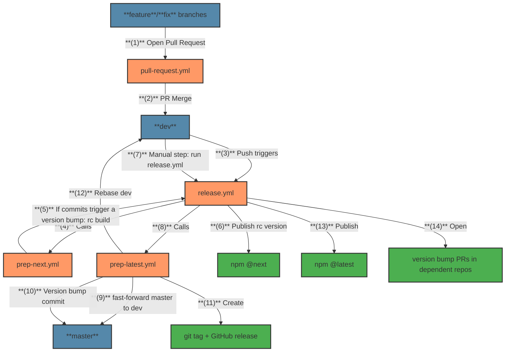

# CI/CD Workflows

This document describes the CI/CD workflows used in this repository.

## Overview

This project uses a Git flow with three main branches:
- **`feature`/`fix` branches**: Used for development of new features or bugfixes
- **`dev` branch**: Integration branch for features/fixes, publishes `@next` npm packages
- **`master` branch**: Production branch, publishes `@latest` npm packages

The repository has four workflows:

| Workflow | Trigger | Role |
| --- | --- | --- |
| `pull-request.yml` | Pull request events | Runs build, lint, type and test checks |
| `release.yml` | Push to `dev`, or manual dispatch | Entry point for all npm publishing |
| `prep-next.yml` | Called by `release.yml` on push to `dev` | Prepares the `rc` build for `@next` |
| `prep-latest.yml` | Called by `release.yml` on manual dispatch | Prepares the production build for `@latest` |

`release.yml` is the npm trusted publisher. It runs `pnpm publish` itself, since the OIDC token is scoped to that workflow. The two prep workflows build, check and upload the `dist` artifact that `release.yml` publishes.

## High-Level Diagram

## Workflow Details

### 1. Pull Request Workflow (`pull-request.yml`)

**Triggered by:**
- Pull request events (`opened`, `synchronize`, `reopened`, `ready_for_review`)

**Steps:**
- **(1) Open Pull Request**: Developer creates PR from `feature`/`fix` branch to dev
- **(2) PR Merge**: After approval and passing checks, PR is merged to dev

**Actions:**
1. Installs dependencies (`pnpm install --frozen-lockfile`)
2. Builds the package (`pnpm run ts:build`), which generates the `generated` dir needed by later checks
3. Runs linting (`pnpm run lint`)
4. Checks types and circular dependencies (`pnpm run ts:check`)
5. Runs tests (`pnpm run test`)

**Notes:**
- Runs only on PRs marked ready for review: draft PRs are skipped
- A new push to the same PR cancels the run in progress
- The job times out after 5 minutes
- Fails if any check fails, preventing merge

### 2. Release Workflow (`release.yml`)

**Triggered by:**
- Push to `dev` branch (typically after PR merge): `rc` release to `@next`
- Manual workflow dispatch (via GitHub Actions UI): production release to `@latest`

**Jobs:**
1. `prep-next`: Calls `prep-next.yml` on push to `dev`
2. `prep-latest`: Calls `prep-latest.yml` on manual dispatch
3. `publish`: Runs when the prep workflow succeeded and uploaded a build artifact
   - Downloads the `dist` artifact
   - On push to `dev`: sets the `rc` version in `package.json` without committing it
   - Runs `pnpm publish` with the `next` tag on push, or the `latest` tag on manual dispatch
4. `sdk-bump-prs`: Runs after a successful production publish
   - Opens a PR in each dependent repo that pins `@nexusmutual/sdk` to the new version
   - Repos: `frontend-next` (base `develop`), `event-scanner`, `order-book` and `workers` (base `dev`)

**Notes:**
- Uses the `production` environment and an OIDC token (`id-token: write`) for npm trusted publishing
- A new run for the same event and branch cancels the run in progress

### 3. Prep Next Workflow (`prep-next.yml`)

**Triggered by:**
- `release.yml` on push to `dev` (reusable workflow, `workflow_call`)

**Steps:**
- **(3) Push triggers**: Merge to dev triggers `release.yml`
- **(4) Calls**: `release.yml` calls `prep-next.yml`
- **(5) If commits trigger a version bump: rc build**: Builds and uploads the `rc` artifact
- **(6) Publish rc version**: `release.yml` publishes the artifact to npm with the `next` tag

**Actions:**
1. Determines if a version bump is needed based on conventional commits on `dev`
2. If needed:
   - Calculates the next `rc` version (e.g., `1.2.0-rc1`, `1.2.0-rc2`)
   - Builds the package, runs linting, type checks and tests
   - Uploads the `dist` artifact as `sdk-next-<rc version>`

**Outputs:** `rc_version`, `artifact_name`, `triggers_bump`

**Notes:**
- Commits nothing to git and publishes nothing to npm: `release.yml` does the publish
- `rc` version is ephemeral and not committed to the repository, to prevent polluting the git history
- Uploads an artifact only if conventional commits indicate a version bump is needed. Without one, `release.yml` skips the publish

### 4. Prep Latest Workflow (`prep-latest.yml`)

**Triggered by:**
- `release.yml` on manual dispatch (reusable workflow, `workflow_call`)

**Steps:**
- **(7) Manual step: run release.yml**: Manually triggered when ready to release
- **(8) Calls**: `release.yml` calls `prep-latest.yml`
- **(9) fast-forward master to dev**: Updates master branch to match dev
- **(10) Version bump commit**: Increments version based on semantic commit messages
- **(11) Create**: Creates git tag and GitHub release
- **(12) Rebase dev**: Updates dev branch with version bump commit
- **(13) Publish**: `release.yml` publishes the artifact to npm with the `latest` tag
- **(14) Open**: `release.yml` opens version bump PRs in dependent repos

**Actions:**
1. Validates that a version bump is needed based on conventional commits on `dev`
2. Fast-forwards `master` branch to match `dev`
3. Bumps version on `master` with `pnpm version` and commits it
4. Builds the package, runs linting, type checks and tests
5. Uploads the `dist` artifact as `sdk-<version>`
6. Creates a git tag and GitHub release
7. Rebases `dev` onto `master` to keep them in sync

**Outputs:** `bumped_version`, `artifact_name`

**Notes:**
- The version bump is committed to the repository
- Fails if no version bump is needed (prevents unnecessary releases)
- Tagging and the dev rebase run in parallel once build and checks pass, before `release.yml` publishes to npm

## Version Bumping Logic

This project uses [conventional-recommended-bump](https://github.com/conventional-changelog/conventional-changelog/tree/master/packages/conventional-recommended-bump) with `.github/config/conventional-bump-setup.js` to determine the appropriate version bump based on commit messages:

- `BREAKING CHANGE` in a commit, or `breaking:` commits, trigger a `major` version bump
- `feat:` commits trigger a `minor` version bump
- `fix:`, `perf:`, `build:`, `chore:`, `refactor:` and `revert:` commits trigger a `patch` version bump

Commits with types `docs:`, `style:`, `test:` or `ci:` do not trigger version bumps.

Please see [CONTRIBUTING.md](CONTRIBUTING.md) for more semantic commit message details.
